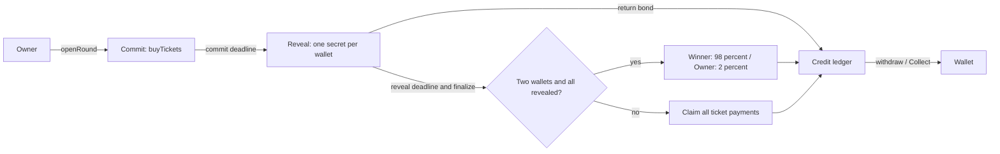

# FairDraw — Decentralized Lottery with Fair Randomness

**Project 10 · Team 7**

| Member | Student ID |
| --- | --- |
| Trương Đức Quốc Huy | 29211154415 |
| Trần Bảo Duy | 28211354517 |

FairDraw is a local Ethereum lottery built with Solidity 0.8.24, Hardhat, Ganache, ethers.js 6 and a Vite web interface. Players buy tickets, commit and reveal private secrets, and let the contract select a winning ticket. Use **Ganache test ETH only**. This educational prototype has not been independently audited.

## Features and rules

| Rule | Default |
| --- | --- |
| Ticket price | 0.01 ETH per ticket |
| Reveal bond | 0.02 ETH per wallet per round |
| Winner's share | 98% of ticket sales |
| Owner's fee | 2% of ticket sales on successful draws |
| Tickets per wallet | Up to 100 per round |
| Round capacity | 1,000 tickets and 100 distinct wallets |
| Minimum participation | Two distinct wallets, with every wallet revealing |
| Default commit / reveal windows | 120 seconds each; minimum 30 seconds each |

Each ticket carries one equally weighted chance to win. A wallet can buy tickets in batches and add more during Commit, using the same secret. It pays only one bond and reveals once for all its tickets. Bonds are separate from the ticket pot.

The interface includes lottery-ball artwork, a ticket quantity selector, ticket and reveal status, account switching, secret backup/restore, withdrawals, round lookup, refunds and owner controls. Decorative ball numbers are illustrations, not draw results.

## Prerequisites

- Node.js and npm. Node 24 was used for the captured checks; Node 22 LTS is also suitable for this tooling.
- Ganache desktop with a funded Ethereum workspace.
- MetaMask installed in the browser used to open the app.

Hardhat is included in the project; installing Truffle separately is unnecessary. Compilation uses the pinned npm solc package and targets the Paris EVM for compatibility.

## Setup in VS Code / Windows PowerShell

Open the repository folder in VS Code, then open **Terminal → New Terminal**. Run commands from the directory containing `package.json`:

```powershell
cd "C:\Users\johnn\Desktop\Blockchains Project\Decentralized-Lottery-with-Fair-Randomness"
npm.cmd ci
npm.cmd test
```

Open Ganache and leave your workspace running. Check that its RPC Server is `http://127.0.0.1:7545`. Then run:

```powershell
npm.cmd run deploy
npm.cmd run dev
```

Open the **Local** URL printed by Vite, usually `http://127.0.0.1:5173/`, in your MetaMask browser. Keep both Ganache and the terminal running. Stop Vite with **Ctrl+C** when finished.

**PowerShell scripts disabled?** Use `npm.cmd` as shown above. This avoids the blocked `npm.ps1` script without changing your execution policy.

### Configure MetaMask

1. Add a custom network with RPC URL `http://127.0.0.1:7545`, currency symbol `ETH`, and the **chain ID printed by deployment**. The Ganache workspace used here returns **1337**.
2. Save the network and select it as the active network. Editing its settings alone does not switch to it. The network's display name can be `Ganache Local`.
3. Import Ganache's first account (index 0) for owner controls, plus two additional funded accounts for players, using their Ganache private keys. Keep these throwaway keys private and never use them with real funds.
4. Click **Connect MetaMask** and approve the connection. MetaMask account names such as “Account 1” do not identify the corresponding Ganache account; compare wallet addresses.
5. To use another player, click **Switch / reconnect account ⇄** beside the wallet button and select the desired imported account in MetaMask.

Ganache's **network ID** (often 5777) and Ethereum **chain ID** are different values. MetaMask needs the chain ID. A suggested network-name warning does not mean that port 7545 must be changed to 8545.

### Use a different RPC or ticket price

Set these variables before deploying a **new contract**:

```powershell
$env:GANACHE_URL = 'http://127.0.0.1:8545'
$env:TICKET_PRICE_ETH = '0.05'
npm.cmd run deploy
```

Defaults are port 7545 and a 0.01 ETH ticket. The bond stays 0.02 ETH and the fee stays 2%. Contract price, bond, fee and owner are immutable. To remove overrides:

```powershell
Remove-Item Env:GANACHE_URL -ErrorAction SilentlyContinue
Remove-Item Env:TICKET_PRICE_ETH -ErrorAction SilentlyContinue
```

Deployment writes `frontend/deployment.json` containing the ABI, contract address, chain ID and RPC URL. This file is ignored by Git because deployments belong to individual Ganache workspaces.

## Play a complete round

### 1. Open the round

Connect Ganache account 0, the deployment owner. Scroll to **Behind the draw**, enter commit and reveal durations, and click **Open round**. For practice, 180 seconds per phase gives more time to switch wallets and sign transactions. Only one round can be active at a time.

### 2. Buy tickets during Commit

Connect a funded player account. Choose **Number of tickets**, then click **Buy tickets / add more** and confirm the payment in MetaMask.

```text
First purchase = ticket quantity × ticket price + one reveal bond
Later purchases = additional quantity × ticket price
```

At the default price, buying 10 tickets initially costs **0.12 ETH**: 0.10 ETH enters the pot and 0.02 ETH is the reveal bond. Adding 5 tickets costs another **0.05 ETH**, with no second bond. Gas is additional.

Expand **Keep your ticket secret safe** and download the private secret backup. The app also saves the secret in this browser before submitting the purchase. Do not clear browser data or change browser profiles without a backup. Top-ups require the same original secret.

Connect a second Ganache wallet and buy tickets before Commit ends. Even 100 tickets from a single wallet cannot produce a successful draw: at least two distinct wallets must participate.

### 3. Reveal once per participating wallet

When the phase becomes **Reveal**, connect each participating wallet and click **Reveal my secret** before the reveal deadline. Each wallet reveals once for all its tickets. The UI shows revealed wallets / participating wallets, separately from the ticket count.

A valid reveal immediately credits the wallet's single bond for withdrawal. If the secret is missing, restore that wallet's downloaded backup. Restore checks the chain, contract, round, wallet and on-chain commitment.

### 4. Finalize and collect

After the reveal deadline, anyone can click **Finalize round**. If at least two wallets entered and every wallet revealed, the contract selects a winning ticket, credits the prize and credits the owner's fee. Connect each wallet and click **Collect** to withdraw its available credits.

Example: wallet A owns 10 tickets and wallet B owns 5. The pot is **0.15 ETH**; A has 10 of the 15 ticket slots and B has 5. The winning wallet receives **0.147 ETH**, the owner receives **0.003 ETH**, and each player's **0.02 ETH bond** is credited separately. The winner can collect its prize and bond together.

### Cancelled rounds and refunds

The round cancels on finalization if fewer than two wallets participated or any wallet failed to reveal. A passed deadline alone does not change the on-chain status: **Finalize round must be called first**.

1. Wait until the reveal deadline passes and finalize the round.
2. Connect the wallet that bought the tickets.
3. Under **Every round has a receipt**, enter the cancelled round number and click **View round**.
4. Click **Claim refund** once to credit the payments for all that wallet's tickets.
5. Click **Collect** to transfer available credits to the wallet.

Revealed bonds were already credited. A missing reveal forfeits the single bond to the owner when the ticket refund is claimed; without a claim, that bond remains escrowed. No fee is charged on cancelled ticket sales. Successful rounds do not offer ticket refunds. Old-round refunds remain available after a new round opens on the same contract.

## Contract design



Only `openRound` is owner-restricted. Ticket purchases, reveals, finalization, eligible refunds and withdrawals follow public rules. The owner cannot close an active round early, redraw it or change its terms.

| Function | Purpose |
| --- | --- |
| `openRound(commitSeconds, revealSeconds)` | Open a round as owner |
| `commitmentFor(roundId, player, secret)` | Calculate a domain-bound commitment |
| `buyTickets(roundId, commitment, quantity)` | Purchase or top up tickets during Commit |
| `buyTicket(roundId, commitment)` | One-ticket convenience entry point |
| `reveal(roundId, secret)` | Verify a wallet's secret and credit its bond |
| `finalize(roundId)` | Settle or cancel after the reveal deadline |
| `claimRefund(roundId)` | Credit all ticket payments for a cancelled round |
| `withdraw(recipient)` | Transfer caller-owned credits to a recipient |
| `getRound`, `getPlayers`, `getTicketOwners`, `tickets`, `credits` | Read round data, unique wallets, weighted entries and balances |

Commitments use:

```text
keccak256(abi.encode(contractAddress, chainId, roundId, player, bytes32Secret))
```

Each valid reveal XORs `keccak256(abi.encode(player, secret))` into a running accumulator, independently of reveal order. The final hash binds the accumulator to this contract, chain and round. Its integer value modulo `totalTickets` selects an entry in `ticketOwners`, which contains one owner address per paid ticket. `getPlayers` contains unique wallets, not repeated ticket entries.

Deadlines do not overlap: Commit uses `< commitDeadline`; Reveal uses `>= commitDeadline && < revealDeadline`; finalization uses `>= revealDeadline`. Contract checks remain authoritative if a stale UI or delayed signature crosses a deadline.

Important state changes emit events: `RoundOpened`, `TicketBought`, `TicketsBought`, `SecretRevealed`, `WinnerSelected`, `RoundCancelled`, `RefundClaimed` and `Withdrawal`.

## Security and fairness limits

- **Block data is unsafe as the sole randomness source.** Public or predictable inputs can be anticipated, and block producers can influence timing and inclusion. Timestamps enforce deadlines here; they do not supply draw entropy. See the [Solidity global variables documentation](https://docs.soliditylang.org/en/latest/units-and-global-variables.html) and [security guidance](https://docs.soliditylang.org/en/latest/security-considerations.html).
- **Secrets must be unpredictable.** The UI uses ethers' cryptographic random-byte generator for 32-byte secrets. Never use passwords, dates or reused secrets. Commitments bind the chain, contract, round and player to prevent copied reveals across domains.
- **The last revealer can force cancellation.** It can calculate the prospective winner and withhold its secret. Cancelling on any missing reveal avoids drawing from a selectively incomplete set, but selective completion and denial of service remain possible. Bonds discourage withholding; they do not guarantee fairness or availability, especially for larger pots or colluding wallets.
- **An address is not a unique person.** One person can control multiple wallets. More paid tickets deliberately give more chances; the wallet cap does not prevent Sybil participation.
- **Pull payments isolate transfers.** Credits are cleared before withdrawal calls, with a reentrancy lock. Failed transfers revert without losing credit; a caller can retry with another recipient. A rejecting recipient cannot block settlement or other users. Unclaimed funds remain escrowed. Forced ETH is outside the credit ledger and has no owner sweep function.
- **Local backups are sensitive.** Secrets are plaintext in localStorage and exported JSON. XSS, device compromise or lost browser storage can expose or lose them. Keep backups private and use only test funds.
- **Economic and randomness assumptions remain.** The owner receives forfeited bonds, creating a beneficiary incentive. Modulo bias is negligible but nonzero for up to 1,000 slots in a 256-bit hash space. A completed draw assumes at least one honest unpredictable secret and all reveals. Production extensions should consider verified VRF with explicit funding, fulfillment and timeout rules.

## Tests and gas analysis

```powershell
npm.cmd test
```

The captured suite has **12 passing tests**. Each test uses a fresh in-process Ganache 7.9.2 chain, independently of the desktop workspace. Coverage includes payouts/events/accounting, empty and single-wallet rounds, cancellation, multi-ticket weighted selection, top-ups, one bond per wallet, quantity limits, full ticket refunds, access control, bad payment, changed commitments, invalid/copied/repeated/late reveals, invalid finalization/refunds, failed transfers, reentrancy and old-round claims. More than three require/revert failure cases are covered.

- `docs/test-results.txt`: captured test output.
- `docs/gas-results.json`: measured receipt `gasUsed`, scenario and compiler settings, including batch purchases and top-ups.

Gas depends on storage state and the operation. Transaction cost is `gasUsed × effectiveGasPrice`. The compiler optimizer uses 200 runs. Packed round metadata and a running accumulator keep finalization independent of participant count; refunds are O(1) claims. Purchasing appends a bounded number of weighted ticket slots (at most 100 per call), so larger batches cost more gas. No unmeasured percentage saving is claimed.

Ganache may print a Node-version-specific µWS warning and fall back to its JavaScript implementation. In the captured test run, that warning did not prevent the tests from passing.

## Build, demo and deliverables

| Command | Result |
| --- | --- |
| `npm.cmd run compile` | Compile the contracts |
| `npm.cmd test` | Compile and run the Ganache tests |
| `npm.cmd run deploy` | Deploy a new contract to desktop Ganache and generate web configuration |
| `npm.cmd run dev` | Start the local Vite web server |
| `npm.cmd run build` | Build `dist/` and copy available deployment configuration |
| `npm.cmd run demo` | Run an automated two-wallet demonstration on a separate contract |

Deploy before building to include the intended `frontend/deployment.json` in `dist/`. Refresh the browser after changing the deployment.

The automated demo advances the desktop chain clock with `evm_increaseTime`, affects the entire workspace, and writes `docs/ganache-demo-results.txt`. Run it before opening a live UI round. It leaves the frontend deployment configuration unchanged. A previous demo transcript is evidence of that run; rerun the script to record a new demonstration of the current contract. Browser signing and MetaMask configuration still need manual verification.

| Path | Deliverable |
| --- | --- |
| `contracts/FairLottery.sol` | Primary Solidity contract |
| `contracts/WithdrawalProbe.sol` | Test-only reentrancy probe |
| `test/lottery.test.cjs` | Automated contract tests |
| `scripts/deploy.cjs`, `scripts/demo.cjs` | Deployment and automated demo |
| `index.html`, `frontend/` | Web app and wallet workflow |
| `output/pdf/team7-project-report.pdf` | Six-page report with diagram, security and gas analysis |
| `scripts/report.py` | Reproducible report source; requires ReportLab, pypdfium2 and Windows Arial fonts |
| `docs/DEMO.md` | Ten-minute live demonstration guide |
| `docs/test-results.txt`, `docs/gas-results.json` | Test and gas evidence |

## Redeployment and old credits

A new deployment has its own rounds and balances. Upgrading does not move credits or tickets from the old contract. The deployment script preserves the previous ABI/address/configuration in `local-deployments/<address>.json`; these local files are ignored by Git.

To revisit an old deployment on the **same Ganache workspace**:

1. Stop Vite and save a copy of the current `frontend/deployment.json` somewhere safe inside the project.
2. Copy the archived configuration for the desired contract over `frontend/deployment.json`.
3. Restart Vite, refresh and reconnect. The UI also supports archived one-ticket deployments for their refunds and credits.
4. Restore the saved current configuration to return to the upgraded contract. Rebuild if serving `dist/`.

Keep the same Ganache workspace and do not reset it while old rounds or funds are needed. Closing and reopening a saved workspace may preserve its chain; resetting or replacing it does not. If the expected contract is gone, redeploy for future rounds. Redeployment cannot recover erased chain state.

## Troubleshooting

| Symptom | What to do |
| --- | --- |
| `npm.ps1` cannot run | Use `npm.cmd` in the VS Code PowerShell terminal |
| Connection refused | Start Ganache and check its RPC URL; start Vite for the website |
| Wrong network | Save **and select** Ganache in MetaMask; use the deployment's chain ID |
| No contract at this address | Check the intended Ganache workspace; redeploy if its chain was reset, then refresh |
| Pending MetaMask request | Open the extension and complete or reject the pending request before retrying |
| Wrong account / owner button disabled | Use **Switch / reconnect account**; compare the wallet with Ganache account 0 |
| Buy button disabled | Check Commit is active, quantity is valid and wallet/round caps are not reached |
| Top-up needs a secret | Restore the original backup; additional tickets must use the same commitment |
| Refund rejected | Finalize after the reveal deadline, confirm cancellation, choose the correct round and ticket-owning wallet; refunds can be claimed only once |
| Refund claimed but wallet balance unchanged | Click **Collect**; claiming adds credit rather than sending ETH immediately |
| Reveal missed | Finalize after the deadline, then claim ticket payments; the missing reveal bond is forfeited |
| Generic JSON-RPC error | Refresh and read the eligibility message; check MetaMask's transaction details and Ganache state before retrying |

Keep private keys and secret backups out of screenshots, commits and presentations. Automated build and contract tests do not prove the browser extension is configured correctly.
