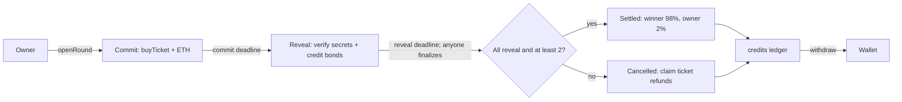

# FairDraw - Decentralized Lottery with Fair Randomness

**Project 10 / Team 7**

| Member | Student ID |
| --- | --- |
| Trương Đức Quốc Huy | 29211154415 |
| Trần Bảo Duy | 28211354517 |

A Solidity 0.8.24 commit-reveal lottery, Hardhat deployment to Ganache, automated Ganache tests, and a Vite/ethers.js/MetaMask web interface. Use local test ETH only. This classroom prototype has not been independently audited.

## Quick start (Windows / PowerShell)

Prerequisites: Node.js 22 LTS (Node 24 also tested in this workspace), npm, Ganache desktop, and MetaMask in a browser. Hardhat is bundled locally; Truffle installation is not needed. The assignment permits either framework. Compiler is installed from npm, so compilation does not download solc separately.

1. Open Ganache, create/open an Ethereum workspace, and leave it running. Its RPC Server should normally be `http://127.0.0.1:7545`. Allow at least 6 accounts with test ETH. Do not use real wallets or a mainnet fork.
2. In this directory:

   ```powershell
   npm ci
   npm test
   npm run deploy
   npm run dev
   ```

3. Open the Local URL printed by Vite (normally `http://127.0.0.1:5173`) in the browser that has MetaMask.
4. In MetaMask, add a custom network with RPC `http://127.0.0.1:7545`, symbol `ETH`, and the **chain ID printed by the deployment script** (often 1337). Ganache's network ID, often 5777, is a different value; do not assume it is the chain ID.
5. Import Ganache account 0 using its local private key for owner controls, and accounts 1 and 2 for players. Keep these throwaway keys local. Connect MetaMask and select the active account when prompted. For a second participant, switch accounts in MetaMask and reconnect after the page reloads.
6. As account 0, open a round. The UI defaults to 120 seconds for each phase. As players 1 and 2, buy tickets **before the commit deadline** and download each secret backup. Choose the number of tickets. The first purchase costs quantity × 0.01 ETH + one 0.02 ETH reveal bond. Later purchases in that round cost quantity × 0.01 ETH, using the same secret and no extra bond.
7. After the commit deadline, reveal from both player accounts before the reveal deadline. Each reveal credits the player's bond for withdrawal.
8. After the reveal deadline, anyone can finalize. The winner receives 0.0196 ETH from a two-ticket round, the owner receives 0.0004 ETH, and both players retain their 0.02 ETH bond credits. Withdraw credits explicitly.

For another RPC URL, set it **before deploying**:

```powershell
$env:GANACHE_URL = 'http://127.0.0.1:8545'
npm run deploy
```

The deploy command creates `frontend/deployment.json` with the ABI, address, chain ID and RPC URL. It is intentionally ignored by Git because each Ganache workspace has its own deployment. `npm run build` creates `dist/`; deploy before building if you want that build to include its network configuration. `npm run dev` serves the source directly. After restarting/resetting Ganache, redeploy and reload the page.

## Contract design



Up to 100 tickets per wallet, 100 unique players, and 1,000 tickets per round. Each paid ticket is one equally weighted chance. A wallet uses one commitment, one reveal and one bond for all its tickets. Additional purchases must use the original commitment. At least two distinct wallets must participate and all must reveal. An address is not proof of a unique person. Fee, price, bond and owner are immutable. Only the owner opens rounds; buying, revealing, finalizing, refunds and withdrawals follow public rules. No owner shortcut closes, redraws, or cancels an active round. Deadlines use chain timestamps, with nonoverlapping intervals: commit `< commitDeadline`; reveal `>= commitDeadline && < revealDeadline`; finalize `>= revealDeadline`.

Commitment:

```text
keccak256(abi.encode(contractAddress, chainId, roundId, player, bytes32Secret))
```

Each validated reveal XORs `keccak256(abi.encode(player, secret))` into an accumulator. The final hash binds that accumulator to this contract, chain, and round, and its integer value modulo the number of tickets selects the winner from ticketOwners, an array containing one owner address per paid ticket. getPlayers returns unique wallets; getTicketOwners returns the weighted entries. The accumulator is independent of reveal order. Winner selection and cancellation do not iterate over participants.

## Security and fairness limits

- Block timestamps, hashes and similar public block data are unsuitable as the sole randomness source: participants can predict public inputs and block producers can influence inclusion/timing. Timestamps here only enforce phase deadlines. See [Solidity security guidance](https://docs.soliditylang.org/en/latest/security-considerations.html) and [global variables documentation](https://docs.soliditylang.org/en/latest/units-and-global-variables.html).
- Uniform, private, independently generated 32-byte secrets are essential. The UI uses ethers' cryptographic random-byte generator. Never choose passwords, dates, or reuse secrets. A completed draw needs at least one honest unpredictable contribution and all reveals.
- The last revealer can calculate the prospective winner and choose to abort. This implementation cancels the entire round if even one reveal is missing; it never selects a winner from a selectively reduced secret set. **Cancellation still permits denial of service and selective completion. It is not an unbiased, always-available production lottery.** The bond discourages withholding; it does not mathematically prevent it, especially with many tickets, collusion, or an owner who also plays.
- On cancellation, each participating wallet calls `claimRefund(roundId)` once. Revealed bonds were already credited. An unrevealed bond is forfeited to the owner **when that player claims the ticket refund**; otherwise it remains escrowed. No ticket-sale fee is charged on cancellation. Owner beneficiary incentives are a limitation; production designs should reconsider penalty distribution.
- Funds use pull payments and checks-effects-interactions with a withdrawal lock. A rejecting recipient cannot block finalization or other accounts; the caller may retry with another recipient. Credits and old-round refunds survive new rounds. Funds never claimed remain in escrow. Forced ETH is outside the credits ledger and cannot be swept by the owner.
- UI secrets are plaintext in localStorage and exported backups. Use only test funds, keep backups private, and reveal from the same browser/profile or restore the backup. Device compromise, XSS or clearing storage can lose the secret. Commitments are domain-bound against copied reveals across users, rounds, contracts and chains.
- Modulo introduces negligible mathematical bias (at most 1,000 outcomes from a 256-bit hash), and hash security is an assumption. No on-chain entropy is perfectly random merely because it is hashed. A production extension should use a verified VRF, with explicitly designed funding, fulfillment and timeout rules.

## Tests, gas and deliverables

`npm test` compiles with local solc and runs automated tests on fresh **in-process Ganache 7.9.2** chains, separate from your desktop workspace. It covers successful settlement/accounting/events, cancellation/refunds, no-player/single-player rounds, access control, bad payment, changed commitments, ticket quantity limits, top-up accounting, weighted selection, invalid/repeated/late reveals, replay protection, early/repeated finalization, failed transfers, reentrancy and old-round claims. Many more than three require/revert cases are covered. Test output and gas data are in `docs/`.

`docs/gas-results.json` records transaction receipt `gasUsed`, compiler settings and scenario. Gas is not an ETH amount: cost = gasUsed × effectiveGasPrice. Price and network affect ETH cost. Optimization: packed round metadata and a running XOR accumulator avoid a settlement loop; purchases append one owner slot per ticket (a bounded loop of at most 100); each player's refund is a separate O(1) claim. This reduces settlement work compared with iterating over all secrets, while persistent storage still costs gas. No unsupported before/after percentage is claimed.

`npm run demo` performs an automated two-player flow on your running desktop Ganache using a **separate contract**. It advances local chain time via `evm_increaseTime` and writes `docs/ganache-demo-results.txt`; run it before opening a frontend round, since time travel affects the whole workspace. It leaves the frontend deployment configuration unchanged.

Files:

- `contracts/FairLottery.sol`: primary contract; `WithdrawalProbe.sol`: test-only attack probe.
- `test/lottery.test.cjs`: reproducible tests; `scripts/deploy.cjs`: Ganache deployment.
- `frontend/` and `index.html`: full browser workflow with backup/restore and account/network checks.
- `output/pdf/team7-project-report.pdf`: six-page report; `scripts/report.py`: reproducible report source.
- `docs/DEMO.md`: 10-minute demo plan; `docs/test-results.txt`: captured test results.

## Troubleshooting

Connection refused: open Ganache and compare its displayed RPC address with `GANACHE_URL`. Incorrect network: use the chain ID printed by deployment. Owner button disabled: connect the account that deployed the contract. Missing deployment: run `npm run deploy`. Transaction rejected: inspect the message and current phase; contract rules remain authoritative even if the UI is stale. A late reveal cannot be recovered: finalize, then claim the ticket refund. After resetting Ganache, use MetaMask's clear activity/nonce data for the local network if transactions become stuck, then redeploy. Never reset a wallet holding real assets for this exercise.

The live MetaMask signing step requires your browser interaction. Automated contract and build checks do not prove that an extension has been configured correctly.

## Multiple tickets and deployment upgrades

Use **Number of tickets** to choose 1-100; the page shows the exact payment before MetaMask approval. You can add tickets during Commit, up to 100 total per wallet. Keep the original secret: one reveal covers every ticket owned by that wallet. Cancellation refunds all ticket payments in one claim; the single bond is returned on reveal or forfeited on a missing reveal. Ten tickets cost 0.10 ETH plus a 0.02 ETH bond on the first purchase.

The default ticket price remains 0.01 ETH as requested. To use a different price on a **new deployment**, set `$env:TICKET_PRICE_ETH = '0.05'` before `npm.cmd run deploy`. Existing contract prices never change.

An upgrade deploys a new contract; old rounds/credits remain in the old contract. The deployment script saves the previous ABI/address/config in `local-deployments/<address>.json`. To revisit old funds, stop the UI server, copy that saved JSON over `frontend/deployment.json`, then restart and reconnect. Rebuild if serving dist. Restore the latest config to return to the upgraded contract. Do not reset Ganache while old funds or rounds are needed.
